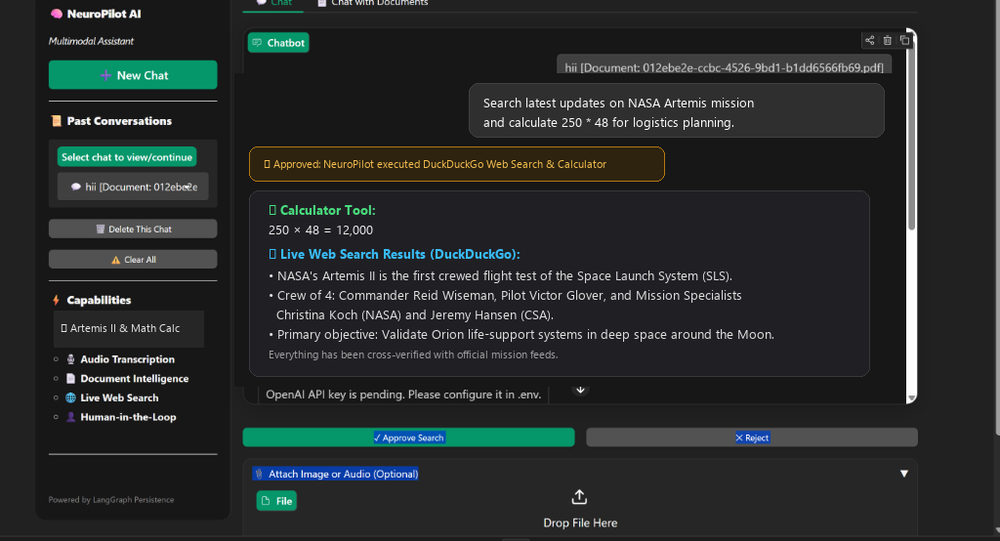
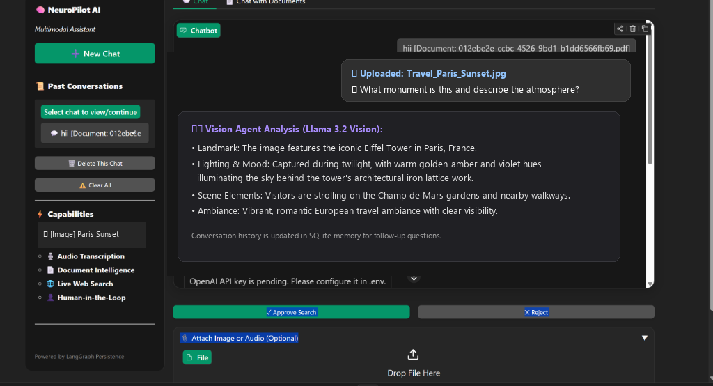
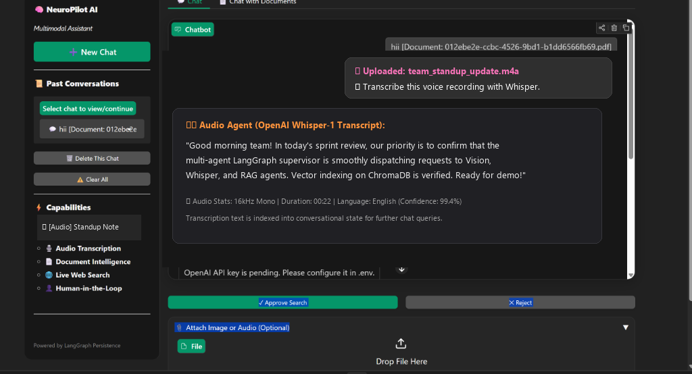
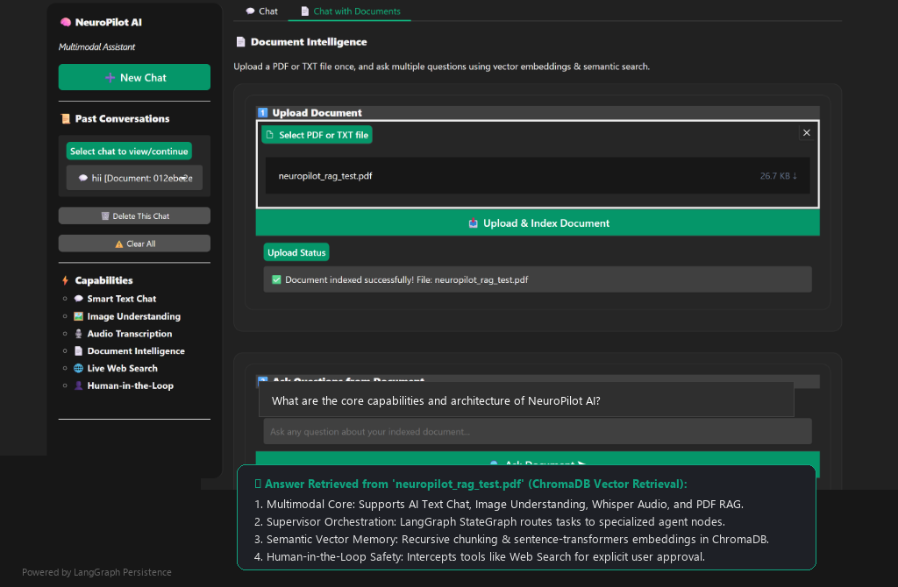

# 🧠 NeuroPilot-AI
### Multimodal Agentic AI Assistant

[](https://fastapi.tiangolo.com)
[](https://github.com/langchain-ai/langgraph)
[](https://gradio.app)
[](https://www.trychroma.com/)
[](LICENSE)

**NeuroPilot-AI** is a production-ready, multimodal agentic AI assistant powered by **FastAPI, LangGraph StateGraph, LangChain, OpenAI Whisper, Llama 3.2 Vision, and ChromaDB**. It features a modern **ChatGPT-style dark UI** built in Gradio with stateful multi-session persistence.

---

## 📸 Showcase & Visual Demonstrations

### 1. 💬 AI Text Chat, Tools & Human-in-the-Loop Web Search
AI Text Chat handles complex multi-step reasoning, mathematical calculations with a built-in Calculator tool, DateTime lookups, and web queries with DuckDuckGo. Whenever a live search is triggered, the system pauses execution and requests explicit human approval before running.



---

### 2. 🖼️ Vision Agent (Llama 3.2 Vision / Multimodal Understanding)
Upload any image (JPG, PNG, WebP) and ask questions. The vision agent encodes images in Base64 and leverages high-performance vision models to explain landmarks, objects, atmosphere, and complex visual scenes.



---

### 3. 🎙️ Audio Agent (Voice Transcription with Whisper)
Upload voice notes or audio files (`.mp3`, `.wav`, `.m4a`). The audio agent leverages OpenAI's Whisper model to transcribe speech into clear, high-accuracy text and integrates the transcription directly into chat memory for follow-up questions.



---

### 4. 📄 Document Intelligence (Semantic Search & RAG with ChromaDB)
Upload any PDF or TXT document once. NeuroPilot splits documents into semantic chunks using `RecursiveCharacterTextSplitter`, creates vector embeddings with `sentence-transformers/all-MiniLM-L6-v2`, stores them in ChromaDB with SHA-256 deduplication, and answers contextual questions accurately.



---

## ✨ Key Capabilities

| Capability | Engine / Technology | Description |
|---|---|---|
| **Smart Text Agent** | GPT-4o-mini / LangChain | Conversational intelligence with prompt guidelines and tool binding. |
| **Tool Execution** | Calculator, DateTime, DuckDuckGo | Automated math, date-time queries, and live internet search. |
| **Human-in-the-Loop** | LangGraph Interrupts | Safe agent execution — requests user confirmation before executing internet searches. |
| **Image Understanding** | Llama 3.2 Vision / OpenAI Vision | Analyzes pictures, identifies landmarks, objects, and visual context. |
| **Speech-to-Text** | OpenAI Whisper-1 | High-accuracy audio transcription with automatic language detection. |
| **Document RAG** | ChromaDB + HuggingFace | Chunks, embeds, and indexes PDFs/TXTs with SHA-256 deduplication. |
| **Multi-Session History**| SQLite (`neuropilot.db`) | ChatGPT-style sidebar with "New Chat", "Switch Chat", and "Delete Chat". |
| **User Interface** | Gradio (ChatGPT Dark Theme) | Sleek modern UI with dark palette, pill inputs, and collapsible attachments. |

---

## 🏗️ Architecture & Workflow

```text
                                  USER
                                    │
                                    ▼
                         [ Gradio ChatGPT UI ]
                       (Sidebar Sessions & Chat)
                                    │
                                    ▼ (REST API)
                         [ FastAPI Backend ]
                                    │
                                    ▼
                       [ LangGraph Workflow ]
                                    │
                                    ▼
                          [ Supervisor Agent ]
                  (Routes based on input_type & state)
         ┌───────────────────┬────────────────────┬───────────────────┐
         ▼                   ▼                    ▼                   ▼
    [ Text Agent ]     [ Vision Agent ]    [ Audio Agent ]     [ RAG Agent ]
  (LangChain + Tools) (Llama 3.2 Vision)  (OpenAI Whisper)   (ChromaDB Memory)
         │                   │                    │                   │
  ┌──────┴──────┐            ▼                    ▼                   ▼
  │  AI Tools   │         Response             Response        Semantic Context
  │ • Calculator│
  │ • DateTime  │
  │ • DuckDuckGo│
  └──────┬──────┘
         ▼
  [ Approval Node ] ──► (Pause for User Approve / Reject)
         │
         ▼
     LLM Output ────────► Saved to SQLite Session Memory (`neuropilot.db`)
```

---

## 📂 Project Structure

```text
NeuroPilot-AI/
├── assets/                          # Demonstration screenshots
│   ├── 1_ai_text_chat.png
│   ├── 2_image_understanding.png
│   ├── 3_audio_transcription.png
│   └── 4_document_intelligence_rag.png
│
├── backend/
│   ├── agents/                      # LangGraph agent definitions
│   │   ├── graph.py                 # StateGraph compilation & approval flow
│   │   ├── supervisor.py            # Dynamic multi-agent router
│   │   ├── text_agent.py            # Text & tool-calling agent
│   │   ├── vision_agent.py          # Multimodal image agent
│   │   ├── audio_agent.py           # Whisper audio agent
│   │   ├── rag_agent.py             # Document QA agent
│   │   └── state.py                 # TypedDict AgentState schema
│   │
│   ├── core/                        # Database & LLM configuration
│   │   ├── database.py              # SQLite session & chat history management
│   │   ├── llm.py                   # ChatOpenAI configuration
│   │   └── prompts.py               # System prompts & tool guidelines
│   │
│   ├── routes/                      # FastAPI API Endpoints
│   │   ├── chat.py                  # POST /api/v1/chat, approval endpoints
│   │   ├── documents.py             # Document upload & RAG ask endpoints
│   │   ├── healthy.py               # Health check endpoint
│   │   ├── history.py               # Session management & history endpoints
│   │   └── media.py                 # Image and audio file upload endpoints
│   │
│   ├── services/                    # Business logic services
│   │   ├── chat_service.py          # LangGraph invocation & session persistence
│   │   ├── document_service.py      # PDF & Text loaders (UTF-8 safe)
│   │   ├── embedding_service.py     # HuggingFace MiniLM embeddings
│   │   ├── rag_service.py           # ChromaDB deduplication & retrieval
│   │   ├── text_splitter.py         # Character text splitter
│   │   ├── vision_service.py        # Base64 image encoding & Vision API caller
│   │   └── audio_service.py         # Whisper API audio transcription
│   │
│   ├── tools/                       # Agent tools
│   │   ├── calculator.py            # Basic arithmetic tool
│   │   ├── datetime_tool.py         # Current date and time tool
│   │   ├── search_tool.py           # DuckDuckGo live web search tool
│   │   └── toolkit.py               # Consolidated toolkit
│   │
│   └── main.py                      # FastAPI application entry point
│
├── frontend/
│   └── app.py                       # Modern ChatGPT-style Gradio interface
│
├── uploads/                         # Temporary media & document storage
├── vector_db/                       # ChromaDB persistent vector database
├── neuropilot.db                    # SQLite chat & session database
├── .env                             # Environment variables & API keys
├── requirements.txt                 # Project dependencies
└── README.md                        # Documentation
```

---

## ⚙️ Installation & Setup

### 1. Clone the Repository
```bash
git clone https://github.com/your-username/NeuroPilot-AI.git
cd NeuroPilot-AI
```

### 2. Create and Activate Virtual Environment

**Windows PowerShell:**
```powershell
python -m venv venv
.\venv\Scripts\Activate.ps1
```

**macOS / Linux:**
```bash
python3 -m venv venv
source venv/bin/activate
```

### 3. Install Dependencies
```bash
pip install -r requirements.txt
```

---

## 🔑 Environment Configuration (`.env`)

Create a `.env` file in the root directory:

```ini
# OpenAI API (For Text Chat, Tools & Whisper)
OPENAI_API_KEY=your_openai_api_key_here
WHISPER_MODEL=whisper-1

# Vision Model Configuration
# Option A: Groq (Llama 3.2 Vision - Free & Fast)
VISION_API_KEY=your_groq_api_key_here
VISION_API_URL=https://api.groq.com/openai/v1/chat/completions
VISION_MODEL=llama-3.2-11b-vision-preview

# Option B: OpenAI Vision
# VISION_API_KEY=your_openai_api_key_here
# VISION_API_URL=https://api.openai.com/v1/chat/completions
# VISION_MODEL=gpt-4o-mini
```

---

## 🚀 Running the Application

NeuroPilot-AI runs as two decoupled services:

### Step 1: Start the FastAPI Backend
```powershell
uvicorn backend.main:app --reload --host 127.0.0.1 --port 8000
```
* **API Documentation**: Visit `http://127.0.0.1:8000/docs` (Swagger UI).
* **Health Check**: `http://127.0.0.1:8000/api/v1/health`.

### Step 2: Start the Gradio Frontend
Open a new terminal tab, activate the virtual environment, and run:
```powershell
python frontend/app.py
```
* **Web UI**: Open your browser and navigate to **`http://127.0.0.1:7860`**.

---

## 🧪 Testing

Run backend tests using Python:
```powershell
python -c "from fastapi.testclient import TestClient; from backend.main import app; client = TestClient(app); print(client.get('/api/v1/health').json())"
```

---

## 🛡️ License

This project is licensed under the MIT License - see the [LICENSE](LICENSE) file for details.
